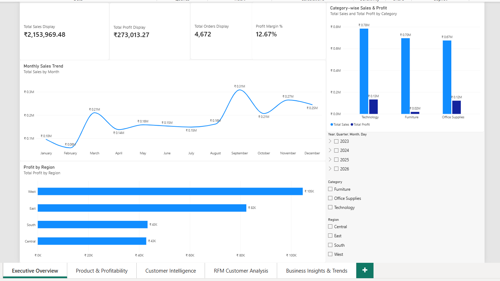
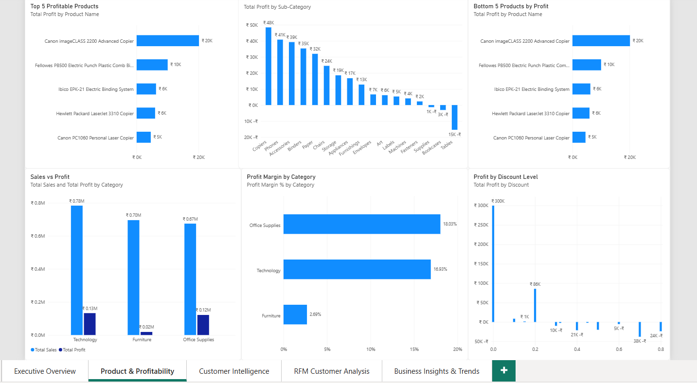
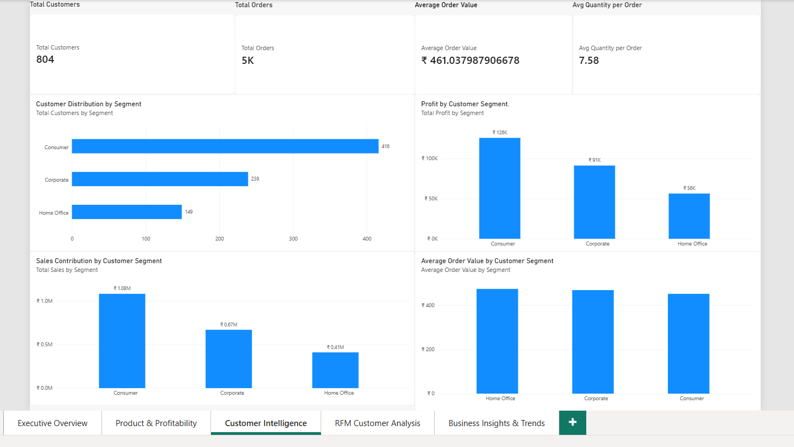
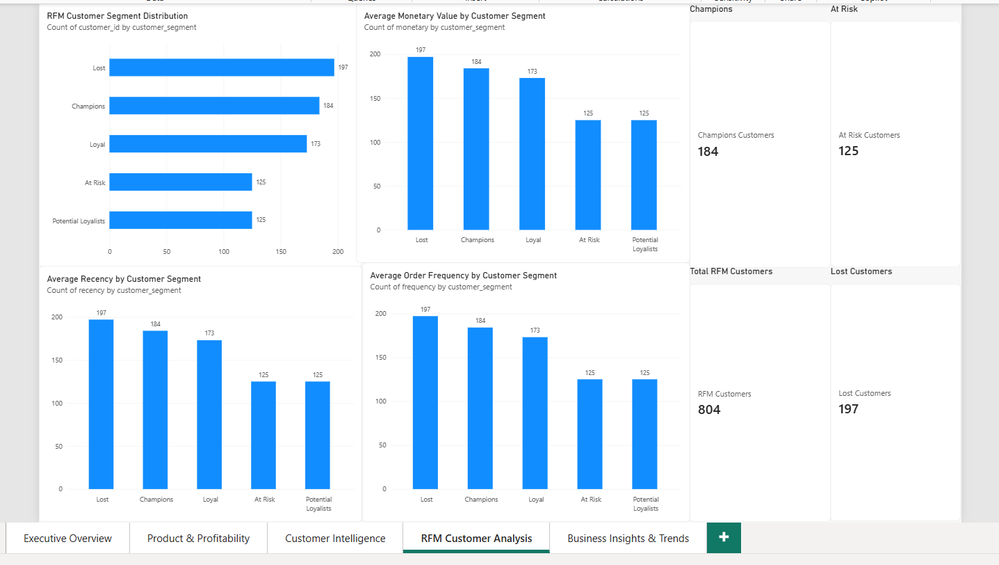
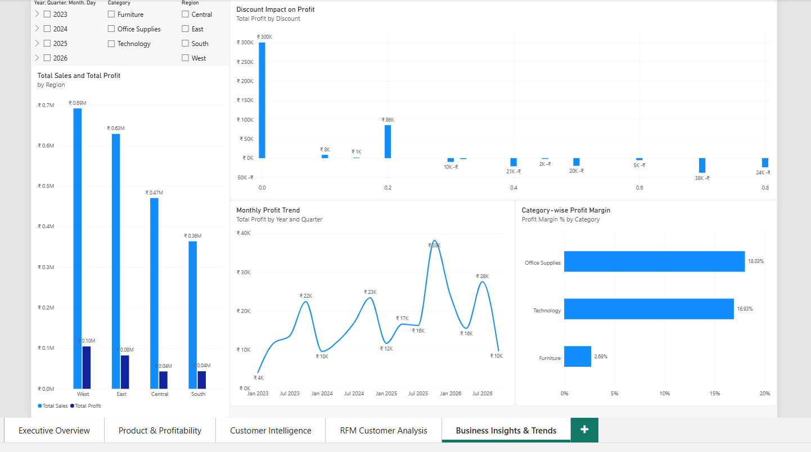

# E-commerce Profitability & Revenue Intelligence

**End-to-end analytics portfolio project** using Python, Pandas, exploratory data analysis, customer segmentation, SQLite, and Power BI.

This project examines sales performance, product profitability, discount patterns, regional results, customer purchasing behaviour, and RFM-based customer segments.

## Project at a glance

| Area | Status |
|---|---|
| Data understanding and quality checks | Completed |
| Data cleaning and validation | Completed |
| Exploratory data analysis | Core analysis completed |
| Customer behaviour and RFM segmentation | Completed; validation totals recorded |
| SQLite business analysis | 15 result tables exported |
| Power BI dashboard | Five-page report committed |
| Profit prediction | Planned; not yet implemented |
| Sales forecasting | Planned; not yet implemented |

## Start here

- **[Open the primary end-to-end notebook](notebooks/Ecommerce_Profitability_Revenue_Intelligence.ipynb)**
- [Open the Power BI dashboard](powerbi/Ecommerce_Profitability_Dashboard.pbix)
- [Read the Power BI report guide](powerbi/README.md)
- [Read the SQL analysis guide](sql/README.md)
- [Review SQL business findings](reports/phase4_sql_business_analysis.md)
- [Review RFM methodology and findings](reports/rfm_customer_segmentation.md)
- [Copy-ready LinkedIn project description](reports/linkedin_project_description.md)

## Key historical results

The historical analysis uses records through **2026-11-06**. The 828 records dated after this cutoff are excluded from historical trend and RFM calculations.

| Metric | Historical result |
|---|---:|
| Sales | **$2,153,969.48** |
| Profit | **$273,013.27** |
| Profit margin | **12.67%** |
| Distinct orders | **4,672** |
| Customers | **804** |
| Historical records | **9,366** |

## Dataset overview

The inspected working workbook contains **10,194 rows × 21 columns**: 9,994 US records and 200 Canadian records. It contains 5,111 unique orders, 804 Customer IDs, and 1,862 products across dates from 2023-01-03 to 2026-12-30. No missing values, exact duplicate rows, or duplicate Row IDs were found.

The workbook differs from the commonly circulated 9,994-row US-only Sample Superstore file. Its exact provenance has not been independently verified; this repository therefore calls it a **modified/extended Superstore-style dataset**, not the canonical original.

## Analysis completed

### 1. Data understanding and cleaning
- Inspected schema, data types, date coverage, geography, missing values, and duplicates.
- Preserved raw and working DataFrame copies.
- Standardized text fields and converted Postal Code to text for mixed numeric/alphanumeric values.
- Validated date order, positive sales and quantity, discount range, Row IDs, and duplicates.

### 2. Exploratory data analysis
- Overall sales, profit, order, customer, and quantity KPIs.
- Category and sub-category profitability.
- Discount-band and category-by-discount analysis.
- Regional performance and monthly sales/profit trends.
- Customer-level sales, profitability, and repeat-versus-one-time analysis.

### 3. RFM customer segmentation
RFM uses historical records through **2026-11-06**, with **2026-11-07** as the reference date. Recency, Frequency (distinct orders), and Monetary (Sales) are calculated per Customer ID. Six project-defined segments are used: Champions, Loyal Customers, New Customers, At Risk, Lost Customers, and Potential Loyalists.

Validation records 804 RFM customers and 804 unique Customer IDs, no missing RFM values, and matching RFM Monetary/Profit totals against historical Sales/Profit. Segment definitions are custom project rules, not universal industry standards. See [the RFM report](reports/rfm_customer_segmentation.md).

### 4. SQL business analysis
Phase 4 uses SQLite on 9,366 historical rows. It covers overall KPIs, category/sub-category performance, discount impact, regions, yearly/monthly trends, products, customer segments, shipping modes, purchase frequency, and state/province analysis.

- 15 CSV result tables: [dataset/phase4_sql_outputs.zip](dataset/phase4_sql_outputs.zip)
- SQL source: [sql/phase4_business_analysis.sql](sql/phase4_business_analysis.sql)
- Findings: [reports/phase4_sql_business_analysis.md](reports/phase4_sql_business_analysis.md)

### 5. Power BI dashboard

The [Power BI report](powerbi/Ecommerce_Profitability_Dashboard.pbix) contains five pages:

1. **Executive Overview** — headline KPIs, sales/profit trends, category and regional performance.
2. **Product & Profitability** — product rankings, sub-category profit, margins, and discount analysis.
3. **Customer Intelligence** — customer segments, sales/profit contribution, and customer metrics.
4. **RFM Customer Analysis** — RFM segment distribution and customer metrics.
5. **Business Insights & Trends** — monthly profit, regional comparison, discount impact, category margins, and slicers.

## Dashboard previews







See [visuals/README.md](visuals/README.md) for the screenshot list.

## Repository structure

```text
.
├── dataset/       Source notes and exported SQL results
├── notebooks/     Primary Colab notebook and supporting data notes
├── powerbi/       PBIX report and documentation
├── reports/       RFM and SQL findings
├── sql/           SQLite analysis script and run guide
├── visuals/       Five Power BI page screenshots
├── requirements.txt
└── README.md
```

## Technology stack

Python, Pandas, NumPy, Matplotlib, Seaborn, scikit-learn, SQLite, Power BI, Google Colab, Jupyter, and GitHub.

## Reproducibility

Install dependencies with `pip install -r requirements.txt`. Open the [primary notebook](notebooks/Ecommerce_Profitability_Revenue_Intelligence.ipynb) in Colab/Jupyter and upload the source workbook when prompted. For SQL, load the cleaned data into a SQLite table named `orders` and follow [sql/README.md](sql/README.md).

Saved notebook outputs are included, but a full restart-and-run-all test in a clean environment has not yet been independently verified. The source workbook is not committed; verify its provenance and redistribution terms before sharing it.

## Data-quality findings and limitations

- 828 rows dated after 2026-11-06 are excluded from historical analysis but retained in the source dataset.
- November 2026 is incomplete at the analysis cutoff.
- Harry Olson is associated with five Customer IDs; two orders are linked to multiple Customer IDs. No IDs have been merged.
- Phase 4 reports 4,678 customer-order associations versus 4,672 distinct Order IDs. An earlier Phase 3 summary reported 5,117 associations, so the phase-to-phase difference is unresolved. The six-association excess in Phase 4 also indicates that some Order IDs map to multiple Customer IDs.
- Phase 3 previously reported 12 one-time customers, while Phase 4 SQL reported 24. This also remains unresolved.
- Discount-band relationships are descriptive associations, not proof of causation.
- Ad spend, web traffic, conversion, inventory, and campaign data are unavailable.

## Future work

1. Rerun the canonical notebook from a fresh Colab runtime and resolve any errors.
2. Reconcile customer/order identity and one-time-customer count discrepancies.
3. Build and evaluate a profit prediction baseline.
4. Develop a time-aware sales forecasting workflow.
5. Document model limitations and business recommendations.

---

*Dataset attribution and redistribution rights should be verified against the original source before the workbook is shared.*
